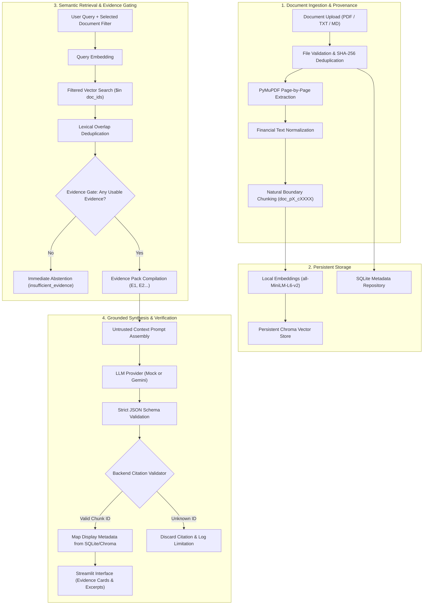

# FinDoc AI — Financial Document Intelligence Copilot

[](https://www.python.org/)
[](https://streamlit.io/)
[](https://www.trychroma.com/)
[]()
[](LICENSE)

> **FinDoc AI** is a document-grounded AI copilot for financial disclosures, annual reports, and policy documents. It indexes documents page-by-page, produces concise answers backed by verified physical page citations, compares terms across two documents, and explicitly abstains with `insufficient_evidence` when source documents lack the requested facts.

---

## 1. The Problem

Financial disclosures (e.g. annual reports, policy terms, fee schedules, regulatory filings) are dense and complex. Standard generative AI chatbots frequently:
- **Hallucinate plausible facts** when an answer is not in the document.
- **Invent page numbers or citation references** that do not correspond to actual text.
- **Vulnerably follow prompt injection instructions** embedded inside untrusted uploaded documents.
- **Fail to show exact evidence excerpts** for human verification.

**FinDoc AI demonstrates a controlled, evidence-grounded approach.** It treats uploaded documents strictly as untrusted reference data, verifies citations against retrieval evidence packs in backend code, and provides a benchmark suite to quantitatively measure retrieval hit rate, citation validity, and abstention accuracy.

---

## 2. System Architecture



For complete technical specifications, see [docs/architecture.md](docs/architecture.md).

---

## 3. Technology Stack & Why Each Component is Used

| Technology | Role in FinDoc AI | Why It Was Chosen |
|---|---|---|
| **Python 3.13** | Core language | Modern typing support, stability, and broad machine learning ecosystem. |
| **Streamlit** | User Interface | Rapid, interactive multi-page web application with built-in reactive state management. |
| **PyMuPDF (`fitz`)** | PDF Text Extraction | Extremely fast text parsing that strictly preserves physical 1-based page numbers. |
| **SentenceTransformers** | Local Embeddings | `all-MiniLM-L6-v2` produces dense semantic vectors locally without external network dependencies. |
| **ChromaDB** | Vector Database | Lightweight persistent vector store with native `$in` document-ID metadata filtering. |
| **SQLite** | Document Repository | Embedded, transactional persistence for document metadata, statuses, and SHA hashes. |
| **Pydantic v2** | Data Contracts | Strict schema validation for document records, chunks, citations, answers, and evaluations. |

---

## 4. Key Capabilities

### 📄 Verifiable Page-Level Provenance
- Ingestion preserves physical PDF page numbers from the parser (`fitz`).
- Chunks never cross physical page boundaries, preventing citation ambiguity.
- Chunks carry deterministic IDs: `doc_{hash}_p{page}_c{index}`.

### 🛡️ Evidence Gating & Hallucination Prevention
- When retrieved passages contain no relevant facts, the copilot immediately abstains with status `insufficient_evidence` without guessing.
- All returned citation IDs are verified by backend code against the query's evidence pack. Hallucinated IDs are discarded before rendering.

### ⚖️ Grounded Two-Document Comparison
- Independent dual retrieval for Document A and Document B.
- Source-side evidence isolation ensures Document A passages are never attributed to Document B.
- One-sided findings are worded responsibly: *"Not found in retrieved passages from Document B"* rather than claiming total document absence.

### 🧪 Live Benchmark Evaluation Suite
- Embedded 18-case labelled benchmark dataset ([data/evaluation/dataset.json](data/evaluation/dataset.json)).
- Measures **Retrieval Hit@K**, **Citation-ID Validity**, **Abstention Accuracy**, and **Prompt Injection Defense**.
- UI displays real measured metrics—never showing fabricated pass rates.

---

## 5. Quickstart & Installation

### Prerequisites
- Python 3.10+ (tested on Python 3.13)
- Git

### Step 1: Clone the Repository
```bash
git clone https://github.com/your-username/findoc-ai.git
cd findoc-ai
```

### Step 2: Set Up Virtual Environment
```bash
python -m venv .venv

# Windows:
.venv\Scripts\activate

# macOS / Linux:
source .venv/bin/activate
```

### Step 3: Install Dependencies
```bash
pip install -r requirements.txt
```

### Step 4: Configure Environment (Optional for Mock Mode)
The application works **100% offline in Mock Mode** without any API key:
```bash
cp .env.example .env
```

To enable live Google Gemini models, edit `.env`:
```env
FINDOC_LLM_PROVIDER=gemini
GEMINI_API_KEY=your_gemini_api_key_here
FINDOC_LLM_MODEL=gemini-2.5-flash
```

### Step 5: Launch the Application
```bash
streamlit run app.py
```
Open your browser at `http://localhost:8501`.

---

## 6. Demo Script & Sample Questions

To demonstrate FinDoc AI in an interview or technical review:

### Step 1: Document Intake
1. Navigate to **Document Library**.
2. Upload the included synthetic sample: `data/samples/Apex_Financial_2024_Report.pdf` (or `apex_financial_2024.txt`).
3. Observe extraction progress, page counts (5 pages), chunk counts, and SHA-256 deduplication.

### Step 2: Grounded Q&A with Physical Page Citation
1. Navigate to **Ask FinDoc**.
2. Select `Apex_Financial_2024_Report.pdf`.
3. Ask:
   > *What is the international wire transfer fee, and what conditions apply to monthly maintenance fee waivers?*
4. Inspect the generated answer, the verified citation cards, and open the evidence excerpt showing **Page 3** and exact dollar figures ($45.00 wire, $5,000 waiver balance).
5. Download the validated report in Markdown or JSON format.

### Step 3: Explicit Abstention on Unanswerable Query
1. In **Ask FinDoc**, ask:
   > *What was Apex Financial's total revenue in the fiscal year 2035?*
2. Observe the clear warning banner: **Insufficient Evidence Found in Selected Documents**. The copilot explicitly abstains rather than inventing future financial numbers.

### Step 4: Two-Document Comparison
1. In **Document Library**, upload `data/samples/Beacon_Lending_Policy_2024.pdf`.
2. Navigate to **Compare Documents**.
3. Select Document A (`Apex Financial`) and Document B (`Beacon Lending`).
4. Enter comparison topic:
   > *Compare fee schedules, charges, and penalty structures.*
5. Review the side-by-side findings cards separating Document A evidence from Document B evidence.

### Step 5: Quality Diagnostics & Benchmark Execution
1. Navigate to **Evaluation & Diagnostics**.
2. Notice the initial status is **NOT RUN** (no fake pass rates).
3. Click **🚀 Run Live Evaluation Benchmark**.
4. Watch the progress bar evaluate 18 test cases across Hit@K, Citation Validity, Abstention, and Injection Defense.
5. Export the evaluation report as Markdown or JSON.

---

## 7. Running the Automated Test Suite

FinDoc AI includes 77 comprehensive unit and integration tests:

```powershell
$env:PYTHONPATH="src"; python -m pytest tests/ -v
```

### Test Coverage Highlights:
- **`tests/unit/test_validation.py`**: File extension, size limits, magic bytes, SHA-256 deduplication, traversal sanitization.
- **`tests/unit/test_parser.py`**: PyMuPDF extraction, physical page numbers, financial decimal preservation, blank/scanned warnings.
- **`tests/unit/test_chunker.py`**: Natural boundary chunking, deterministic chunk IDs, page isolation.
- **`tests/unit/test_vector_store.py`**: Persistent ChromaDB operations, `$in` document filtering, document chunk deletion.
- **`tests/unit/test_answer_service.py`**: Evidence gating, LLM provider fallback, citation ID validation, prompt injection safety.
- **`tests/unit/test_comparison.py`**: Distinct document requirements, dual evidence packs, cross-source citation rejection.
- **`tests/unit/test_evaluation.py`**: Benchmark runner, retrieval recall@k, abstention accuracy, injection resistance.
- **`tests/integration/`**: End-to-end PDF ingestion, deduplication, deletion consistency, and multi-page citation answering.

---

## 8. Product Boundaries & Disclaimer

> [!IMPORTANT]
> **Learning & Portfolio Prototype**: FinDoc AI is an assistive document reading prototype, **not** financial, legal, accounting, investment, or lending advice.
> 
> - **Synthetic / Public Data Only**: Do not upload private banking records, customer personal data, account numbers, or confidential corporate filings.
> - **Untrusted Reference Data**: All uploaded document text is treated strictly as passive reference data, never as instructions.
> - **External Provider Notice**: When running in live Gemini mode, user queries and retrieved document excerpts are transmitted to the configured Google Gemini API endpoint.

---

## 9. Project Structure

```
FinDoc AI/
├── app.py                             # Multi-page Streamlit web application
├── requirements.txt                   # Dependency manifests
├── .env.example                       # Configuration template
├── src/findoc/
│   ├── config.py                      # Application settings via pydantic-settings
│   ├── errors.py                      # Structured domain exception hierarchy
│   ├── schemas.py                     # Validated Pydantic contracts
│   ├── reporting.py                   # Markdown and JSON report formatters
│   ├── ingestion/
│   │   ├── validation.py              # File upload validation & SHA-256 hashing
│   │   ├── parser.py                  # PyMuPDF page-aware text extraction
│   │   ├── chunker.py                 # Natural boundary chunking with page IDs
│   │   └── service.py                 # Ingestion coordinator service
│   ├── storage/
│   │   ├── metadata_store.py          # SQLite document metadata repository
│   │   ├── vector_store.py            # Persistent ChromaDB vector index adapter
│   │   └── embeddings.py              # Local sentence-transformers & mock embedders
│   ├── retrieval/
│   │   ├── evidence.py                # EvidencePack and citation resolver
│   │   └── retriever.py               # Filtered search and lexical deduplication
│   ├── generation/
│   │   ├── prompts.py                 # Grounded Q&A and comparison prompts
│   │   ├── provider.py                # BaseLLMProvider, MockLLMProvider, Gemini adapter
│   │   └── answer_service.py          # Grounded answering and citation validation
│   ├── comparison/
│   │   └── service.py                 # Two-document comparison coordinator
│   └── evaluation/
│       └── runner.py                  # Benchmark evaluation and quality diagnostics
├── data/
│   ├── samples/                       # Synthetic financial reports & lending policies
│   └── evaluation/                    # 18-case labelled benchmark dataset
├── docs/
│   ├── architecture.md                # Technical design & data flow specifications
│   └── evaluation.md                  # Evaluation methodology & metrics guide
└── tests/
    ├── unit/                          # 72 unit tests across all subsystems
    └── integration/                   # 5 end-to-end pipeline & answer flow tests
```

---

## 10. License

This project is licensed under the [MIT License](LICENSE).
